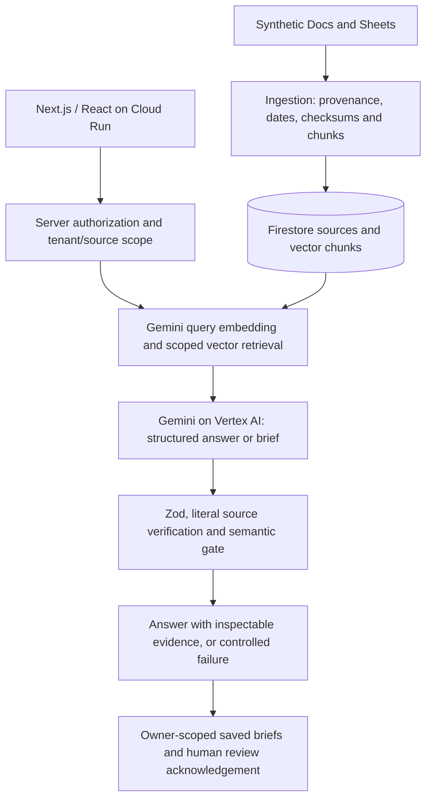

# KnowBridge

> Status reviewed 2026-10-18. Latest recorded release: `knowbridge-00021-tft`; 294 local tests across 39 files. Full deployed benchmark reliability remains open. See [current readiness](docs/READINESS.md).

[](https://github.com/alfianhid/knowbridge/actions/workflows/ci.yml)

Connecting knowledge to confident decisions. KnowBridge helps project leaders at Southeast Asian, English-first SMEs using Google Workspace investigate scattered evidence, reconcile changing forecasts, and prepare explainable decision briefs. Built for **Google AI Builder Cup 2026 - Future of Work & Enterprise Productivity**.

**Live app:** [Open KnowBridge on Cloud Run](https://knowbridge-208529907910.asia-southeast1.run.app)

[Presentation PDF](docs/deck/KnowBridge-Submission-Deck.pdf) | [Demo video script](docs/VIDEO-SCRIPT.md) | [Submission checklist](docs/SUBMISSION.md) | [Recorded results](docs/PHASE5-RESULTS.md)

> **All demo organizations, people, emails and records are fictional.** Generated recommendations require human verification. A saved or reviewed brief is not an approved business decision. This is a controlled prototype, with unresolved model-service reliability issues.

## For judges: 60 seconds

For saved briefs, use **Judge sign-in** with credentials supplied privately by the submitter. Accounts remain usable through 6 November 2026 (WIB); sessions renew automatically. Public Ask needs no login. Workspace import requires a separate approved fictional demo Google account. See [judge access](docs/JUDGE-SESSION.md).

- **Problem:** client expectations, QA forecasts and approval records live in different Docs and Sheets. A newer date alone cannot tell a project leader what they may commit to.
- **What we built:** a source catalog, grounded questions with inspectable citations, temporal/conflict analysis, and protected saved decision briefs with human review acknowledgement.
- **Google AI is central:** Gemini on Vertex AI embeds source chunks and synthesizes structured answers and briefs. Literal citation validation and a separate semantic review gate check generated output before delivery.
- **Working deployment:** Next.js runs on Google Cloud Run with Firestore storage and vector retrieval. Public search uses only the isolated fictional demo corpus; brief creation requires an authorized demo identity.
- **Reproducible evidence:** the seed contains 168 documents, 24 sheets, 1,904 rows and 12 gold cases. The bounded evaluation profile indexes 55 sources, not the entire corpus.
- **Honest results:** both latest recorded complete deployed benchmark runs passed **2/12**, with ten HTTP 503 service failures each. Earlier complete runs and focused retries remain separate evidence. Full-suite reliability remains open; see [Phase 5 results](docs/PHASE5-RESULTS.md).

## The problem

A project leader asks: **"Can Project Harbour launch on 1 Nov?"** The answer must distinguish a customer target from a newer QA forecast, inspect security approval, and establish whether anyone authorized a revised commitment. A summary that merges those facts can create a false promise.

KnowBridge brings the evidence together with source IDs, literal excerpts and historical dates. Missing evidence is reported as **insufficient evidence**; document effective dates stay distinct from Drive update timestamps. The target audience — owners, project managers and operations leads at 10-100-person services SMEs using Google Workspace across Southeast Asia — is a product hypothesis; adoption and time savings have not been measured.

## What it does

| Step | What happens | Access |
|---|---|---|
| 1. Inspect sources | Browse the fictional catalog and open original stored text, owners and dates. | Public synthetic demo |
| 2. Ask and reconcile | Ask a project question; inspect citations, forecast changes, pending approvals and unknowns. | Public synthetic demo; real Gemini in cloud mode |
| 3. Prepare and review | Generate a decision brief, save it, reopen it and deliberately acknowledge human review. | Authorized demo member; Firebase ID token required |

Ask the Harbour question on the [live app](https://knowbridge-208529907910.asia-southeast1.run.app) — the facts to verify are:

| Evidence | Meaning | Source |
|---|---|---|
| 2026-11-01 | Client target | `HBR-DOC-02` |
| 2026-11-11 | Latest QA completion forecast; not completed work | `HBR-DOC-04` |
| PENDING | Production security approval | `HBR-DOC-06` |
| No revised delivery commitment authorized | No evidence of an approved replacement commitment | `HBR-DOC-09` |
| No pilot approved | A draft pilot is not approval | `HBR-DOC-15` |

These facts support a conditional recommendation for human review. They do not prove that launch is definitely impossible.

## Why not just ask ChatGPT, Claude or Gemini?

General AI assistants are the right tool for broad knowledge, drafting and open-ended research — and KnowBridge itself runs on Gemini. The difference is the workflow around the model: KnowBridge is a decision-evidence tool for one bounded corpus, with rules a chat answer does not enforce.

| | General AI assistants | KnowBridge |
|---|---|---|
| Evidence | Web pages and uploaded files, summarized | Only authorized Docs/Sheets; stable source IDs, owners and recorded dates kept |
| Citations | Helpful links and quotes, not checked against the source | Every quoted excerpt must literally exist in the stored original; fabricated citations fail the answer closed |
| Conflicting dates | The newest statement usually wins the summary | Baseline / forecast / commitment / approved decision is typed; document effective date stays distinct from the Drive updated timestamp |
| Missing evidence | Usually still answers | Answers "insufficient evidence" — abstention is product behavior |
| Access | Depends on chat and connector permissions | Retrieval is restricted to the requesting tenant/user before any context reaches the model |
| Output | Chat transcript | Saved Decision Brief with a deliberate human review acknowledgement |

This is a design comparison of typical general-assistant behavior in 2026, not a measured head-to-head benchmark of those products.

## How Google AI grounds the answer

Retrieval selects authorized tenant/user evidence **before** Gemini receives context. The server validates structured output with Zod, checks cited IDs and literal excerpts against stored originals, and applies a separate semantic assessment. Unsupported output fails closed; unavailable providers return a controlled error.

Cloud mode uses actual Gemini synthesis. Local mode performs deterministic lexical evidence lookup and explicitly provides **no AI synthesis**. KnowBridge does not claim autonomous decision-making or an agent tool-use loop.

## Architecture



| Layer | Technology and role |
|---|---|
| App | Next.js App Router, React and TypeScript; one deployable web app and API |
| AI | Google Gen AI SDK, Gemini on Vertex AI, 768-dimensional embeddings |
| Persistence | Firestore sources, vector chunks, saved briefs and durable quotas; local file store for development |
| Identity | Firebase ID-token verification and server-enforced tenant/owner authorization |
| Deployment | Google Cloud Run in `asia-southeast1`, managed service identity and Secret Manager |
| Optional connector | Google Picker selected-file import of registered fictional Docs/first-tab Sheets; separate owner-scoped storage |

Cloud Run location does not imply Singapore-only model processing. Recorded generation uses `global` and embeddings use `us-central1`. See [architecture](docs/ARCHITECTURE.md), [retrieval setup](docs/RETRIEVAL.md) and [security](docs/SECURITY.md).

## Repository guide

Application code lives in `src/`, operator commands in `scripts/`, tests in `tests/`, and the reproducible fictional corpus in `seed/generated/`. Start with the [documentation index](docs/README.md); historical reports live in [the archive](docs/archive/README.md) and raw benchmark/isolation records in [evidence](docs/evidence/README.md). See [project structure](docs/PROJECT-STRUCTURE.md) for folder ownership.

## AI Builder Cup theme and submission

KnowBridge addresses the official [Future of Work & Enterprise Productivity theme](https://aibuildercup.com/themes.html) — knowledge access, collaboration and everyday decisions — with source-backed investigation and explainable decision briefs. The [official requirements](https://aibuildercup.com/themes.html) call for Google AI, Cloud Run or Firebase deployment, English materials, a PDF deck and a three-minute demo video; KnowBridge uses Gemini on Vertex AI and Cloud Run. On 18 October the user confirmed the demo video has not yet been produced and will be updated later. Submission confirmation and exact dashboard cutoff/timezone remain unrecorded; confirm the final category and artifact links in the competition dashboard.

| Official judging criterion | Weight | KnowBridge evidence |
|---|---|---|
| Technical Merit & Gen AI Implementation | 40% | [Architecture](docs/ARCHITECTURE.md), [evaluation methodology](docs/EVALUATION.md), [actual benchmark results](docs/PHASE5-RESULTS.md) |
| Problem Alignment & Impact | 25% | [User hypothesis and Harbour story](docs/PRD.md); no measured productivity benefit claimed |
| Innovation & Creativity | 25% | Temporal distinctions, approval scope, literal citations and explicit unknowns |
| User Experience & Solution Design | 10% | Source inspection, saved/reviewed briefs and [accessibility acceptance limits](docs/ACCEPTANCE.md) |

This README does not assert completed submission or organizer approval.

## Run locally

Requires Node.js 22.18+ and Python 3.11+.

**macOS / Linux:**

```bash
npm ci
python3 scripts/verify_seed.py
export KNOWBRIDGE_STORE=file
export KNOWBRIDGE_RETRIEVAL=local
npm run ingest:local
npm run dev
```

**Windows (PowerShell):**

```powershell
npm.cmd ci
python scripts\verify_seed.py
$env:KNOWBRIDGE_STORE="file"
$env:KNOWBRIDGE_RETRIEVAL="local"
npm.cmd run ingest:local
npm.cmd run dev
```

Open http://localhost:3000. Empty storage shows an empty catalog until ingestion runs. Keep both mode variables set in the same shell for ingestion and the app; shell settings override `.env` settings, including an existing cloud profile. The trusted local ingestion CLI does not open an unauthenticated HTTP mutation path, and `ingest:local` is a script name, not a forced storage backend.

Ask “Can Project Harbour launch on 1 Nov?” to inspect client expectations, newer QA forecasts, pending security and decision records. Local responses quote evidence; they do not generate recommendations, and absent evidence returns `insufficient_evidence`. Health reports configuration readiness, never verified connectivity.

Notes:
- On Windows, use `npm.cmd` if script policy blocks `npm.ps1`; if `python` is not on PATH, try `& "$env:LOCALAPPDATA\Programs\Python\Python311\python.exe" scripts/verify_seed.py`. On macOS/Linux use `python3` (or `python` if that is your Python 3).
- For cloud settings, the vector schema and the exact one-time index command, see [retrieval setup](docs/RETRIEVAL.md). Load the cloud profile explicitly for Firestore/Vertex CLI commands; `npm run index:vectors` is a trusted operator step after cloud source ingestion.

## Verify

```bash
npm run lint && npm run typecheck && npm test && npm run build
npx playwright install chromium
npm run test:e2e
npm audit
```

On Windows PowerShell, use `npm.cmd run lint; npm.cmd run typecheck; npm.cmd test; npm.cmd run build`, `npx.cmd playwright install chromium`, `npm.cmd run test:e2e`, `npm.cmd audit`.

The suite covers 294 unit/integration tests across 39 files. Browser tests require a production build and the local 18-source import; Playwright starts its own local server. Tests cover mobile reflow, keyboard access, forced colors, source selection, retry and axe checks. These checks do not certify complete accessibility. You reported successful manual 400% zoom, text-spacing, screen-reader and 12-case semantic reviews; details are limited as described in [acceptance evidence](docs/ACCEPTANCE.md). Automated full-run reliability remains open. See [current readiness](docs/READINESS.md).

## Benchmark evaluation

The 12 gold cases live in `seed/generated/evaluation.json`. These `node` commands work the same on Windows, macOS and Linux. Three run modes exist; their totals are never aggregated:

```
# 1. Local CLI suite against Firestore/Vertex (15s case pacing for shared embedding quota)
node --env-file=.env scripts/run-typescript.cjs scripts/evaluate.ts
# Focused retry of one case; writes a separate artifact and never replaces full-run totals
node --env-file=.env scripts/run-typescript.cjs scripts/evaluate.ts -- --case=CASE-HBR
# 2. Deployed-API suite over HTTP with independent /api/sources citation verification
node scripts/run-typescript.cjs scripts/evaluate-deployed.ts --revision=<serving-revision>
# 3. Eight live adversarial semantic regressions
node --env-file=.env scripts/run-typescript.cjs scripts/check-semantics.ts
```

The deployed evaluator writes timestamped full-run or case-specific reports under ignored `.data/evaluations/` (use `--out=<path>` for another destination); preserve reviewed records under [evaluation evidence](docs/evidence/README.md). A pass requires the expected status (`supported`, or `insufficient_evidence` for empty-evidence cases), every required source ID cited, every excerpt literally present in its verified source, and fact coverage (exact target/QA dates and security status appear in answer text). Reports record per-case outcomes, failures, latency and request counts; the harness does not measure billing. See [evaluation methodology](docs/EVALUATION.md) and recorded results in [readiness](docs/READINESS.md).

## Deploy

```
gcloud auth application-default login
gcloud config set project YOUR_GCP_PROJECT_ID
gcloud services enable firestore.googleapis.com identitytoolkit.googleapis.com run.googleapis.com
gcloud firestore databases create --database="(default)" --location=asia-southeast1 --type=firestore-native
gcloud run deploy knowbridge --source . --region asia-southeast1 --allow-unauthenticated --memory 512Mi --cpu 1 --port 8080 --max-instances 3
```

Set environment variables and mount `GOOGLE_OAUTH_CLIENT_SECRET` / `GOOGLE_PICKER_API_KEY` from Secret Manager as documented in [cloud setup](docs/DEPLOYMENT.md). Cloud Run requires `KNOWBRIDGE_STORE=firestore` and `KNOWBRIDGE_RETRIEVAL=vertex`; file storage is refused. After deployment, confirm the serving revision, `GET /api/health` configuration and one real cited answer from `POST /api/ask` before claiming a working deployment.

## Data and hero facts

The complete reproducible dataset contains 168 fictional documents, 24 sheets, 1,904 rows, 8 projects, 30 invented staff and 12 gold evaluation cases. Apps Script native Workspace seeding is optional; see `apps-script/README.md`.

Harbour customer target: 2026-11-01 (`HBR-DOC-02`). QA forecast: 2026-11-11, recorded 2026-10-10 (`HBR-DOC-04`). Security approval: PENDING (`HBR-DOC-06`). No revised full-release commitment or pilot approval exists (`HBR-DOC-09`, `HBR-DOC-15`). A forecast/readiness mismatch is not proof a customer expectation was never made.

**All organizations, people, emails and records are fictional.** No customer data, legal approval or production certification is claimed.

## Access and cloud setup

- **Saved briefs** require Vertex AI, Firestore and a verified, revocation-checked Firebase ID token with `knowbridgeMember:true` (or ingestion admin) plus `knowbridgeTenant:"demo-north-quay"`. Judges use the browser email/password sign-in supplied privately by the operator; the SDK renews tokens automatically and judge access ends after 6 November 2026 (WIB), enforced on the server. Create saves automatically; then reopen the brief, inspect source text and deliberately record human review — review is acknowledgement, never launch approval. Local mode retains public synthetic search but cannot generate briefs. See [brief setup](docs/DEPLOYMENT.md#decision-brief-setup).
- **Public reads** expose only `demo-north-quay` synthetic records; caller headers cannot select private tenants. Public invocation on Cloud Run is intentional — authorization is enforced in the application.
- **Ingestion** (`POST /api/ingest`) requires a verified, revocation-checked Firebase ID token with `knowbridgeAdmin:true` and `knowbridgeTenant:"demo-north-quay"`; static ingestion tokens are unsupported. Body size is capped at 16 KiB; each admin can ingest five times per minute, enforced by the shared store.
- **Mutations are protected:** brief creation also requires `Idempotency-Key`, and Workspace routes require the connected owner session.
- **Secrets:** set cloud variables from `.env.example`; use ADC locally and the assigned managed service identity on Cloud Run. Never commit keys or bake them into images; `secrets/` and `.secrets/` are excluded from Git and Docker. The container uses `npm ci`, standalone Next output and a non-root runtime. See [deployment](docs/DEPLOYMENT.md) for required API/database/IAM setup.

## Security

The public `/api/ask` route enforces a durable daily model-call budget with `Retry-After`; system prompts forbid prompt disclosure; the container base image is digest-pinned; the runtime service account is least-privileged. Full security posture, the OWASP GenAI/API control mapping and residual risks: [security](docs/SECURITY.md). Hardening reduces risk; it does not make this demo production-compliant.

## Workflow and tracking

Use [current readiness](docs/READINESS.md) as the status source; Phase 1/2/3 result files are historical snapshots, and the staged prompts should only run when their entry gates match current readiness. The [audit tracker](https://github.com/alfianhid/knowbridge/issues/21) records findings and verification; local plans/results live under `docs/archive/`. Planning targeted team formation 2026-10-14, internal submission 2026-10-17 and final submission 2026-10-18; the registration checkpoint was confirmed, and the exact dashboard cutoff remains a dashboard fact.

## Optional Workspace selected-file demo

Workspace is implemented and defaults off in source. The panel binds Google consent to an authorized demo member and imports at most three registered fictional native Docs/first-tab Sheets; search, literal source inspection, cancellation and disconnect cleanup are owner-scoped, and public Ask and saved briefs retain the separate seed corpus. Real-data import remains prohibited. All seven Workspace issues were recorded closed on `knowbridge-00011-xx4` ([follow-up](docs/archive/WORKSPACE-FOLLOWUP-2026-10-17.md)); see [Workspace setup](docs/WORKSPACE.md) and [current readiness](docs/READINESS.md).

## Implementation and verification history

Phase 1 delivers a bounded synthetic catalog with durable ingestion and provenance (source IDs, recorded/effective dates, literal text, chunks, SHA-256 checksums) over local files (`.data/sources`) or Firestore, with the same store for ingestion and reads ([retrieval setup](docs/RETRIEVAL.md)). Phase 2 adds `/api/ask` with Gemini 768-dimensional embeddings, scoped vector retrieval and structured answers with verified literal citations; local mode is deterministic lexical lookup with no AI synthesis. Phase 3 adds protected brief creation, saved list/detail, review acknowledgement and source inspection ([deployed brief evidence](docs/archive/CLOUD-BRIEF-VERIFICATION-2026-10-16.md)).

Phase 5 shipping work is recorded in [Phase 5 results](docs/PHASE5-RESULTS.md): 12-case benchmark artifacts (full runs and separate focused retries), a Cloud Run permission review, the deck PDF and the demo video script, plus unresolved issues. Synthesized answers pass a structured semantic gate after citation checks; eight live adversarial regressions are recorded. Latest complete deployed benchmarks each passed 2/12, with earlier runs and focused retries as separate evidence; human semantic review of all 12 cases and manual accessibility checks were user-reported on 16 October without complete reviewer/environment details. None of this establishes full benchmark reliability, broad model accuracy or production readiness. See [acceptance](docs/ACCEPTANCE.md) and [readiness](docs/READINESS.md).
