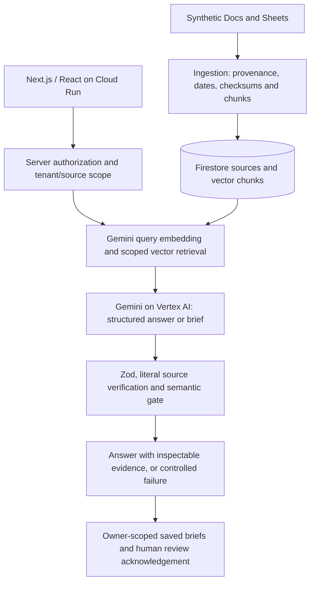

# KnowBridge

[](https://github.com/alfianhid/knowbridge/actions/workflows/ci.yml)

Connecting knowledge to confident decisions. KnowBridge helps project leaders at Singapore-first, English-first SMEs using Google Workspace investigate scattered evidence, reconcile changing forecasts, and prepare explainable decision briefs. Built for **Google AI Builder Cup 2026 - Future of Work & Enterprise Productivity**.

**Live app:** [Open KnowBridge on Cloud Run](https://knowbridge-208529907910.asia-southeast1.run.app)

[Presentation PDF](docs/deck/KnowBridge-Submission-Deck.pdf) | [Demo video script](docs/VIDEO-SCRIPT.md) | [Submission checklist](docs/SUBMISSION.md) | [Recorded results](docs/PHASE5-RESULTS.md)

> **All demo organizations, people, emails and records are fictional.** Generated recommendations require human verification. A saved or reviewed brief is not an approved business decision. This is a controlled prototype, with unresolved model-service reliability issues.

## For judges: 60 seconds

For saved briefs, use **Judge sign-in** with credentials supplied privately by the submitter. Accounts remain usable through 6 November 2026 (WIB); sessions renew automatically. Public Ask needs no login. Workspace import requires a separate approved fictional demo Google account. See [judge access](docs/JUDGE-SESSION.md).

- **Problem:** client expectations, QA forecasts and approval records live in different Docs and Sheets. A newer date alone cannot tell a project leader what they may commit to.
- **What we built:** a source catalog, grounded questions with inspectable citations, temporal/conflict analysis, and protected saved decision briefs with human review acknowledgement.
- **Google AI is central:** Gemini on Vertex AI embeds source chunks and synthesizes structured answers and briefs. Literal citation validation and a separate semantic review gate check generated output before delivery.
- **Working deployment:** Next.js runs on Google Cloud Run with Firestore storage and vector retrieval. Public search uses only the isolated fictional demo corpus; brief creation requires an authorized demo identity.
- **Reproducible evidence:** the seed contains 168 documents, 24 sheets, 1,904 rows and 12 gold cases. The bounded evaluation profile indexes 55 sources, not the entire corpus.
- **Honest results:** both latest recorded complete deployed benchmark runs passed **2/12**, with ten HTTP 503 service failures each. Earlier complete runs and focused retries remain separate evidence. Full-suite reliability remains open; see [Phase 5 results](docs/PHASE5-RESULTS.md).

## The problem, and who it is for

KnowBridge targets owners, project managers and operations leads at 10-100-person services SMEs using Google Workspace, starting in Singapore. This audience is a product hypothesis; real-world adoption and time savings have not been measured.

A project leader asks: **"Can Project Harbour launch on 1 Nov?"** The answer must distinguish a customer target from a newer QA forecast, inspect security approval, and establish whether anyone authorized a revised commitment. A summary that merges those facts can create a false promise.

KnowBridge brings the evidence together with source IDs, literal excerpts and historical dates. Missing evidence is reported as **insufficient evidence**. Document effective dates remain distinct from Drive update timestamps.

## What it does: three steps

| Step | What happens | Access |
|---|---|---|
| 1. Inspect sources | Browse the fictional catalog and open original stored text, owners and dates. | Public synthetic demo |
| 2. Ask and reconcile | Ask a project question; inspect citations, forecast changes, pending approvals and unknowns. | Public synthetic demo; real Gemini in cloud mode |
| 3. Prepare and review | Generate a decision brief, save it, reopen it and deliberately acknowledge human review. | Authorized demo member; Firebase ID token required |

Start at the [live app](https://knowbridge-208529907910.asia-southeast1.run.app) and ask the Harbour question. The facts to verify are:

| Evidence | Meaning | Source |
|---|---|---|
| 2026-11-01 | Client target | `HBR-DOC-02` |
| 2026-11-11 | Latest QA completion forecast; not completed work | `HBR-DOC-04` |
| PENDING | Production security approval | `HBR-DOC-06` |
| No revised delivery commitment authorized | No evidence of an approved replacement commitment | `HBR-DOC-09` |
| No pilot approved | A draft pilot is not approval | `HBR-DOC-15` |

These facts support a conditional recommendation for human review. They do not prove that launch is definitely impossible.

## How Google AI grounds the answer

Retrieval selects authorized tenant/user evidence **before** Gemini receives context. The server validates structured output with Zod, checks cited IDs and literal excerpts against stored originals, and applies a separate semantic assessment. Unsupported output fails closed; unavailable providers return a controlled error.

Cloud mode uses actual Gemini synthesis. Local mode performs deterministic lexical evidence lookup and explicitly provides **no AI synthesis**. KnowBridge does not claim autonomous decision-making or an agent tool-use loop.

## Architecture



| Layer | Technology and role |
|---|---|
| App | Next.js App Router, React and TypeScript; one deployable web app and API |
| AI | Google Gen AI SDK, Gemini on Vertex AI, 768-dimensional embeddings |
| Persistence | Firestore sources, vector chunks, saved briefs and durable quotas; local file store for development |
| Identity | Firebase ID-token verification and server-enforced tenant/owner authorization |
| Deployment | Google Cloud Run in `asia-southeast1`, managed service identity and Secret Manager |
| Optional connector | Google Picker selected-file import of registered fictional Docs/first-tab Sheets; separate owner-scoped storage |

Cloud Run location does not imply Singapore-only model processing. Recorded generation uses `global` and embeddings use `us-central1`. See [architecture](docs/ARCHITECTURE.md), [retrieval setup](docs/RETRIEVAL.md) and [security](docs/SECURITY.md).

## Repository guide

Application code lives in `src/`, operator commands in `scripts/`, tests in `tests/`, and the reproducible fictional corpus in `seed/generated/`.

Use the [documentation index](docs/README.md) for current guides. Historical reports live in [the archive](docs/archive/README.md); raw benchmark and isolation records live in [evidence](docs/evidence/README.md). See [project structure and cleanup policy](docs/PROJECT-STRUCTURE.md) for folder ownership and the research behind this layout.

## AI Builder Cup theme and submission

The official [Future of Work & Enterprise Productivity theme](https://aibuildercup.com/themes.html) focuses on knowledge access, collaboration, decisions and everyday work. KnowBridge addresses this through source-backed project investigation and explainable decision briefs.

The [official requirements](https://aibuildercup.com/themes.html) call for Google AI or the listed agentic platforms, deployment on Cloud Run or Firebase, English submission materials, a PDF proposal deck and a three-minute public demo video. KnowBridge uses Gemini on Vertex AI and Cloud Run. The PDF and video script are linked above; a published video is not yet recorded in the submission evidence.

| Official judging criterion | Weight | KnowBridge evidence |
|---|---|---|
| Technical Merit & Gen AI Implementation | 40% | [Architecture](docs/ARCHITECTURE.md), [evaluation methodology](docs/EVALUATION.md), [actual benchmark results](docs/PHASE5-RESULTS.md) |
| Problem Alignment & Impact | 25% | [User hypothesis and Harbour story](docs/PRD.md); no measured productivity benefit claimed |
| Innovation & Creativity | 25% | Temporal distinctions, approval scope, literal citations and explicit unknowns |
| User Experience & Solution Design | 10% | Source inspection, saved/reviewed briefs and [accessibility acceptance limits](docs/ACCEPTANCE.md) |

Confirm the final category, artifact links and exact cutoff in the competition dashboard. This README does not assert completed submission or organizer approval.

## Run locally

Requires Node.js 22.18+ and Python 3.11+. On PowerShell use `npm.cmd` if script policy blocks `npm.ps1`.

```powershell
npm.cmd ci
python scripts/verify_seed.py
$env:KNOWBRIDGE_STORE="file"
$env:KNOWBRIDGE_RETRIEVAL="local"
npm.cmd run ingest:local
npm.cmd run dev
```

Open http://localhost:3000. Empty storage shows an empty catalog until ingestion runs. The trusted local ingestion CLI does not open an unauthenticated HTTP mutation path.

Keep both mode variables set in the same shell for ingestion and the app. Shell settings override Next.js `.env` settings, including an existing cloud profile. `ingest:local` is a script name, not a forced storage backend. For Firestore/Vertex CLI commands, load the cloud profile explicitly as shown in [retrieval setup](docs/RETRIEVAL.md).

Ask “Can Project Harbour launch on 1 Nov?” to inspect client expectations, newer QA forecasts, pending security and decision records. Local responses quote evidence; they do not generate recommendations. Absent evidence returns `insufficient_evidence`.

For cloud settings, vector schema, the exact one-time index command and indexing instructions, see [Phase 2 setup](docs/RETRIEVAL.md). `npm.cmd run index:vectors` is a trusted operator step after cloud source ingestion. Health reports configuration readiness, never verified connectivity.

If the Python launcher cannot locate the user installation:
```powershell
& "$env:LOCALAPPDATA\Programs\Python\Python311\python.exe" scripts/verify_seed.py
```

## Verify

```powershell
npm.cmd run lint
npm.cmd run typecheck
npm.cmd test
npm.cmd run build
npx.cmd playwright install chromium
npm.cmd run test:e2e
npm.cmd audit
```

Browser tests require a production build and the local 18-source import. Playwright starts its own local server. Tests cover mobile reflow, keyboard access, forced colors, source selection, retry and axe checks. These checks do not certify complete accessibility. You reported successful manual 400% zoom, text-spacing, screen-reader and 12-case semantic reviews; details are limited as described in [acceptance evidence](docs/ACCEPTANCE.md). Automated full-run reliability remains open. See [current readiness](docs/READINESS.md).

## Benchmark evaluation

The 12 gold cases live in `seed/generated/evaluation.json`. Three run modes exist and their totals are never aggregated:

```powershell
# 1. Local CLI suite against Firestore/Vertex (15s case pacing for shared embedding quota)
node --env-file=.env scripts/run-typescript.cjs scripts/evaluate.ts
# Focused retry of one case; writes a separate artifact and never replaces full-run totals
node --env-file=.env scripts/run-typescript.cjs scripts/evaluate.ts -- --case=CASE-HBR
# 2. Deployed-API suite over HTTP with independent /api/sources citation verification
node scripts/run-typescript.cjs scripts/evaluate-deployed.ts --revision=<serving-revision>
# 3. Eight live adversarial semantic regressions
node --env-file=.env scripts/run-typescript.cjs scripts/check-semantics.ts
```

The deployed evaluator writes timestamped full-run or case-specific reports under ignored `.data/evaluations/`. Use `--out=<path>` to select another destination; preserve reviewed records under [evaluation evidence](docs/evidence/README.md).

An automated pass requires the expected status (`supported`, or `insufficient_evidence` for empty-evidence cases), every required source ID cited, every excerpt literally present in its verified source, and fact coverage (exact target/QA dates and security status appear in answer text). Reports record per-case outcomes, failures, latency and request counts; the harness does not measure dollar billing. See [evaluation methodology](docs/EVALUATION.md) and recorded results in [readiness](docs/READINESS.md).

## Deploy

```powershell
gcloud auth application-default login
gcloud config set project YOUR_GCP_PROJECT_ID
gcloud services enable firestore.googleapis.com identitytoolkit.googleapis.com run.googleapis.com
gcloud firestore databases create --database="(default)" --location=asia-southeast1 --type=firestore-native
gcloud run deploy knowbridge --source . --region asia-southeast1 --allow-unauthenticated --memory 512Mi --cpu 1 --port 8080 --max-instances 3
```

Set environment variables and mount `GOOGLE_OAUTH_CLIENT_SECRET` / `GOOGLE_PICKER_API_KEY` from Secret Manager as documented in [cloud setup](docs/DEPLOYMENT.md). Cloud Run requires `KNOWBRIDGE_STORE=firestore` and `KNOWBRIDGE_RETRIEVAL=vertex`; file storage is refused. After deployment, confirm the serving revision, `GET /api/health` configuration and one real cited answer from `POST /api/ask` before claiming a working deployment.

## Data and hero facts

The complete reproducible dataset contains 168 fictional documents, 24 sheets, 1,904 rows, 8 projects, 30 invented staff and 12 gold evaluation cases. Apps Script native Workspace seeding is optional; see `apps-script/README.md`.

Harbour customer target: 2026-11-01 (`HBR-DOC-02`). QA forecast: 2026-11-11, recorded 2026-10-10 (`HBR-DOC-04`). Security approval: PENDING (`HBR-DOC-06`). No revised full-release commitment or pilot approval exists (`HBR-DOC-09`, `HBR-DOC-15`). A forecast/readiness mismatch is not proof a customer expectation was never made.

**All organizations, people, emails and records are fictional.** No customer data, legal approval or production certification is claimed.

## Access and cloud setup

Decision briefs require Vertex AI, Firestore and a valid Firebase ID token with `knowbridgeMember:true` (or ingestion admin) plus `knowbridgeTenant:"demo-north-quay"`. Judges use the browser email/password sign-in supplied privately by the operator. The SDK renews short-lived tokens automatically and preserves sign-in across reloads within the browser session. Judge account access ends after 6 November 2026 (WIB), enforced on the server. Manual token input remains an operator fallback when browser sign-in is disabled. Create saves automatically; refresh/reopen saved briefs, inspect source text, then deliberately record human review. Review is acknowledgement, never launch approval. Local mode retains public synthetic search but cannot generate briefs. See [brief setup](docs/DEPLOYMENT.md#decision-brief-setup).

Public reads expose only `demo-north-quay` synthetic records. Caller headers cannot select private tenants. `POST /api/ingest` requires a verified, revocation-checked Firebase ID token with `knowbridgeAdmin:true` and `knowbridgeTenant:"demo-north-quay"`. Static ingestion tokens are no longer supported. Body size is capped at 16 KiB; each admin can ingest five times per minute. The shared store enforces the ingestion quota.

Set cloud variables from `.env.example`; use ADC locally and the assigned managed service identity on Cloud Run. Never commit keys or bake them into images. Both `secrets/` and `.secrets/` are excluded from Git and Docker. See `docs/DEPLOYMENT.md` for required API/database/IAM setup.

The container uses `npm ci`, standalone Next output and a non-root runtime. A nonce-based CSP protects production scripts. Dependency overrides are pinned and must be rechecked on upgrades. Mutation endpoints are protected: brief creation requires a revocation-checked Firebase ID token and `Idempotency-Key`, ingestion requires the ingestion-admin claim, and Workspace routes require the connected owner session. Public invocation on Cloud Run is intentional; authorization is enforced in the application and public reads are pinned to the synthetic demo tenant.

## Security

Security posture, the OWASP GenAI/API control mapping, least-privilege IAM, the durable model-call budget, and residual risks are documented in [security](docs/SECURITY.md). Key points: the public `/api/ask` route enforces a durable daily model-call budget with `Retry-After`, system prompts forbid prompt disclosure, the container base image is digest-pinned, and the runtime service account is least-privileged. Hardening reduces risk; it does not make this demo production-compliant.

## Workflow and tracking

[Audit tracker](https://github.com/alfianhid/knowbridge/issues/21) records findings and verification. Local plan/results: `docs/archive/AUDIT-REMEDIATION-PLAN.md`, `docs/archive/AUDIT-TRACKER.md`.

Use [current readiness](docs/READINESS.md) as the status source; Phase 1/2/3 result files are historical snapshots. Follow the staged prompts only when their entry gates match current readiness. Phase 4 Workspace integration remains optional and should stay on synthetic files until its authorization, lifecycle and residency issues are resolved.

The original planning documents specify team formation on 2026-10-14, internal submission on 2026-10-17 and final submission on 2026-10-18. The user confirmed the registration checkpoint; exact competition-dashboard cutoff remains a dashboard fact.

## Optional Workspace selected-file demo

Latest follow-up: [final deployment and acceptance](docs/archive/WORKSPACE-FOLLOWUP-2026-10-17.md). Revision `knowbridge-00011-xx4` and the matching maintenance image include the reviewed Drive-401 lifecycle fix; 256 tests pass. Registered-file import/search/source checks, changed/trash rejection, separate-member isolation, real revoked-grant cleanup, denial/reconnect and repeated disconnect are recorded with their limits. The account is left disconnected with no credentials/imported copies. #37/#38 are closed; other issue closures/provider-contract decisions are tracked in [readiness](docs/READINESS.md). Original full benchmark artifacts remain unchanged; Phase 5 clearance is not implied. The paragraph below preserves the earlier checkpoint.

Phase 4 is implemented and defaults off in source. The separate Workspace panel binds Google consent to an existing demo member, imports only registered fictional native Docs/first-tab Sheets, and supports scoped search, literal source inspection and disconnect cleanup. Public search and saved briefs keep using the separate seed corpus. Revision `knowbridge-00009-7j5` serves five reviewed audit/live fixes. The fictional-account consent/Picker/three-file import/search/citation/retry/cancel/disconnect path passed; cleanup removed credentials and imported copies. See [live evidence and remaining negative checks](docs/archive/WORKSPACE-LIVE-ACCEPTANCE-2026-10-17.md) and [pre-Phase 5 audit](docs/archive/PRE-PHASE5-AUDIT-2026-10-17.md). Local suite: 249 tests. Complete deployed Ask benchmark: 10/12, median 27.4 seconds including failures/source verification. Earlier full and focused runs remain separate evidence. Approved concise GitHub status comments were posted; all seven Workspace issues remain open. No real Workspace data is permitted.

## Implementation and verification history

Phase 5 shipping work is recorded in [Phase 5 results](docs/PHASE5-RESULTS.md): recorded 12-case benchmark artifacts (full runs and separate focused retries), a Cloud Run permission review with live mutation probes, the public-repo confirmation, exact evaluation/deploy instructions, the deck PDF and the demo video script, plus the artifact-URL checklist and unresolved issues. Full-suite benchmark reliability under intermittent provider-side failures remains open and is reported honestly there.

Phase 1 implements a bounded synthetic source catalog, durable ingestion and provenance. Default import contains 16 Harbour documents and 2 sheets. The explicit evaluation profile contains 55 sources across eight projects and both launch-readiness policy revisions; see [retrieval setup](docs/RETRIEVAL.md). Source IDs, historical recorded/effective dates, literal text, chunks and SHA-256 checksums are retained.

Local development uses durable files under ignored `.data/sources`. Cloud Run requires Firestore. Ingestion and catalog/detail reads use the same store. Imports survive restart, concurrent retries skip unchanged records, and metadata changes refresh stored records. Failed imports report actual failure counts.

Phase 2 adds `/api/ask`, Gemini 768-dimensional embeddings, scoped Firestore vector retrieval and structured answers with verified literal citations. Local mode is deterministic lexical evidence lookup with no AI synthesis. Phase 3 adds protected brief creation, saved list/detail, review acknowledgement and source inspection. The deployed app and one authenticated Harbour brief create/retry/list/reopen/source verification passed; see [current readiness](docs/READINESS.md) and [deployed brief evidence](docs/archive/CLOUD-BRIEF-VERIFICATION-2026-10-16.md). This does not establish full benchmark reliability, broad model accuracy or production readiness.

Synthesized answers pass a structured semantic gate after citation checks. Eight live adversarial regressions passed. The full benchmark runs recorded 9/12 and 10/12 automated passes; focused retries passed the failed cases, but do not convert either full run into a pass. You reported successful human semantic review of all 12 cases and manual accessibility checks on 2026-10-16; reviewer and environment details were not recorded. The deployed brief still has `reviewedByHuman:false`. See [acceptance evidence](docs/ACCEPTANCE.md), [benchmark results](docs/archive/EVALUATION-RESULTS-2026-10-15.md), and [readiness](docs/READINESS.md).
